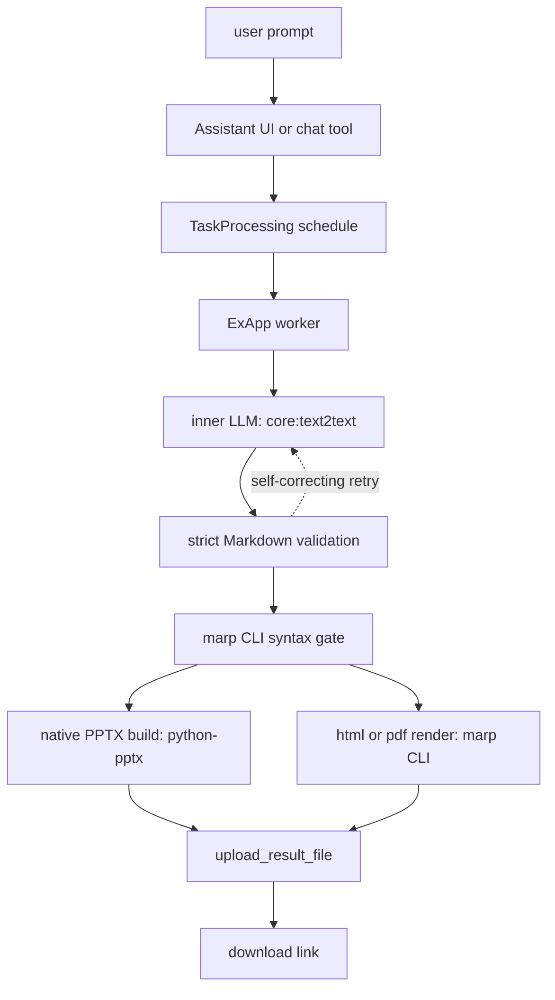

<div align="center">

# marp_slides

**Turn a prompt into a native, editable slide deck.**

A Nextcloud AppAPI ExApp: pptx, html or pdf authored from plain language.

[](LICENSE)
[](#quick-start)
[](#quick-start)

</div>

---

## Why

Slide generation inside Nextcloud today means either a Collabora round trip that converts a document you already wrote into slides, or filling JSON into a template with a fixed layout. Neither takes "explain X to audience Y" and hands back a finished deck.

Language models can write slides, but two things break when you bolt one onto an office suite. Raw model output needs validation before it becomes a deliverable, and the easy rendering path, rasterizing slides to images, produces decks nobody can edit afterwards.

marp_slides takes a plain prompt, has the instance's own text provider author strict Marp Markdown, validates it against an explicit construct allow-list, and rebuilds it as native PowerPoint content: real text boxes, list paragraphs, tables, hyperlinks, speaker notes. Or it renders a standalone HTML presentation or a PDF. The pptx opens editable in PowerPoint, OnlyOffice and Collabora. Anything the model writes that cannot map to native content is rejected with a message that says what to do instead; nothing degrades silently.

## Quick start

You need Nextcloud 33 to 35 with the [AppAPI](https://github.com/nextcloud/app_api) app, a configured `core:text2text` provider (this app schedules the instance's own provider, it never calls a model API), and the AppAPI docker deploy daemon.

<!-- NOTE: the clone URL below is a placeholder; update it if the repository is published under a different org or moves. -->
```bash
git clone https://github.com/WSHAPER/marp_slides.git
cd marp_slides
docker build -t marp-slides:0.1.0 .
```

Register the app on your instance, manually with occ or through whatever deployment automation already manages your AppAPI apps:

```bash
occ app_api:app:register marp_slides \
  --json-info "$(cat appinfo/info.xml | jq -Rs '{info: .}')" \
  --force-scopes --wait-finish
```

Then ask for a deck from the Assistant or any chat tool that schedules TaskProcessing work; the download link comes back when the task reports.

Editing a generated deck in place needs an office integration. Where Collabora's viewer app is present, the pptx opens and edits there; git-based Nextcloud 35 no longer ships that app, so office files do not open in-app until the platform's viewer migration lands on the Nextcloud 36 line. Pinning the viewer app at v35.0.2 restores it in the meantime (nextcloud/richdocuments#6218). The deck itself is unaffected: the download opens and edits in PowerPoint, OnlyOffice or desktop LibreOffice, and the html and pdf outputs need no office integration at all.

## Task contract

The task type takes a required text `prompt`, an optional `output_format` enum (`pptx` default, `html`, `pdf`), and an optional `images` list of Nextcloud file ids the server access-checks for the requesting user. It returns the generated deck as a file plus the retained Marp Markdown source. The canonical shape lives in `marp_slides/task_definition.py`.

`output_format` is a real ENUM shape with three registered values plus a default of `pptx`, and it is validated again inside the provider.

### Constructs

`SUPPORTED_CONSTRUCTS` in `marp_slides/constructs.py` is the single source of truth: the deck-authoring prompt (sourced from `marp_slides/prompts/` at runtime) is rendered from the constant and the validator rejects anything the builder cannot map, so the two can never disagree.

- one `#` or `##` heading per slide as its title, with rich inline runs rendered in the title placeholder
- `###` and deeper headings inside a slide become bold sub-section text at stepped sizes
- plain paragraphs, unordered and ordered lists (nested by 2-space indent, ordered lists honor their start number)
- inline `**bold**`, `*italic*` and `` `code` `` as native run properties
- inline, autolink and reference-style http(s) links as native text-run hyperlinks; URLs are validated, not just parsed, and only full `http://` or `https://` passes
- fenced code blocks as bordered monospace boxes with deterministic wrapping and a shrink-to-fit font ladder (11 to 8 pt); a block too large for one slide is rejected with a split-it hint
- blockquotes as indented italic paragraphs
- pipe tables with rich cell content (links, bold, code)
- speaker notes from `<!-- ... -->` comments on their own lines, as native editable notes slides
- deck-level `<!-- footer: ... -->` and `<!-- header: ... -->` chrome on every slide, with per-slide `_footer` and `_header` overrides
- `paginate: true` as real slide-number fields, deck-wide and per-slide solid background colors, two-column slides via `<!-- columns: 2 -->` plus `<!-- column-break -->`
- `#file:N` image references resolved against the task's `images` input, downloaded with sniffed type and size caps (PNG or JPEG, 5 MB)
- YAML frontmatter with exactly: `marp: true` (the literal scalar, YAML 1.1 spellings like `yes` reject on purpose), `title` (a string), `theme: default`, optional `paginate` and `backgroundColor`

Anything outside the list is rejected at validation time with an error that tells the model what to do instead: raw HTML, remote image URLs, math equations (`$...$` and `$$...$$` LaTeX; the message says to write the formula as plain text), strikethrough, underscore emphasis, footnotes, link schemes outside http/https, control characters in URLs, ragged tables, tables on column slides, oversized code blocks, unknown frontmatter keys, stray `---` separators. There is no image fallback and no render-mode knob.

## Architecture



- The worker is a background thread polling `next_task` every 5 s, woken immediately by AppAPI `/trigger` events. Chromium is involved in exactly one path: only `output_format=pdf` renders through the bundled browser; the syntax gate, the PPTX build and the HTML render are browserless.
- When the inner LLM output fails extraction or validation, one self-correcting retry is scheduled with the validation error appended as feedback; gate, build and prompt failures are never retried. Progress reports at four phases (5% author, 50% validate, 80% build, 100% done) and both attempts share one total-time cap (`MARP_SLIDES_TOTAL_LLM_TIMEOUT`, default 480 s).
- Visual parity with a browser render is not a goal; nativeness and editability are.
- Every failure path ends in `report_result` with an actionable `user_facing_error_message`: invalid Markdown errors embed the parser output, inner LLM failures surface the nested task's error text, image-cap violations name the file id, the cap and the remedy.

The codebase is small enough to read top-down.

## Output formats

**pptx** (default) is rebuilt as native content with python-pptx on 16:9 title and Title+Content layouts: headings become title placeholders, body placeholders carry paragraphs, lists and quotes, code fences and tables become sequential native shapes, column slides become two side-by-side text boxes.

**html** is rendered by marp CLI as one standalone file: theme CSS and the viewer JavaScript are inlined, with no external stylesheet or script assets. Speaker notes stay inside as hidden elements and are available in the bundled presenter view. No browser is needed or spawned; the conversion is Node-only.

**pdf** is the one format that uses the Chromium bundled in the base image, driven by marp CLI through puppeteer-core. The browserless syntax gate runs first, so malformed Markdown fails fast and only a validated deck reaches the slower browser render. Speaker notes are not part of marp's default PDF output (the retained Markdown source carries them); hyperlinks survive as clickable annotations.

ODP is deliberately not offered: neither the native builder nor marp CLI can emit it. If ODF output ever becomes a requirement, the path is PPTX to ODP conversion via Collabora.

Every task also uploads the final validated Marp Markdown as `<deckname>.md` next to the deck, so a later turn can refeed the original prompt plus this source for small edits instead of a full recompute.

## Security

- The allow-list is the boundary. The deck-authoring prompt is generated from `SUPPORTED_CONSTRUCTS` and the validator rejects anything outside it, so prompt and validator cannot drift. Raw HTML never reaches a render: the deck validator rejects it and marp additionally runs with `html` and `looseYAML` off. There is no fallback mode that quietly downgrades content.
- Images enter only as Nextcloud file ids in the `images` slot: the server authenticates the requesting user's access to every id before the task reaches the ExApp, and downloads go over the app-context API with sniffed type and size caps. Remote image URLs are rejected on purpose; fetching them would need its own egress design (redirects, private-IP ranges, DNS rebinding, content caps).
- marp's default emoji handling swaps every emoji for `cdn.jsdelivr.net` image references, fetched at render time or by the viewer's browser. The strict `.marprc` used for all conversions disables the conversion, so emoji stay local-font text and no render touches a CDN.
- Run `https://` for `NEXTCLOUD_URL` (the shared-secret header travels on every ExApp to server call), bind `APP_HOST` to the specific interface Nextcloud reaches instead of `0.0.0.0` on shared machines, firewall 9090 to that interface plus localhost, and egress-restrict the container to `NEXTCLOUD_URL`.
- Deck-failure logs carry a 240-character excerpt of the generated Markdown only, never the user prompt; `MARP_SLIDES_LOG_EXCERPT=false` suppresses the excerpt while the error line always logs.

## Development

```bash
python3 -m venv .venv
.venv/bin/pip install -r requirements_dev.txt
.venv/bin/pre-commit install     # same gates, client-side
scripts/check.sh                 # all quality gates + the 401 tests
.venv/bin/pytest -q              # tests alone: fakes only, no Nextcloud, no docker
```

### Quality gates

`scripts/check.sh` runs the full static gate suite (plus the tests) and stops
at the first failure; `.pre-commit-config.yaml` runs the same core gates on
every commit. What runs, and why it is in the suite:

Each gate exists because it caught real issues in this codebase. See `scripts/check.sh` and `pyproject.toml` for the configuration.

Documented exemptions, each inline in the code with a reason: `process_task`
carries the only complexity/size noqas (the 5%/50%/80% pipeline phases read
best sequentially) — everything else in `marp_slides/` is at or under every
ceiling. Known non-goals: per-function nesting depth and module size are not
directly gated (branch count and complexity are the proxies), and dead
*functions* rely on review, not vulture.

Not standalone tools on purpose: pylint (fully covered by ruff + mypy at a
fraction of the noise), radon (ruff's C901 is the same cyclomatic check),
bandit (ruff's `S` rules cover it; the `marp` subprocess calls go through an
injected argv-list runner with no `shell=True` anywhere), and pip-audit
(dependency CVEs are a different, network-dependent job — run it in CI, not
in the offline gate suite).

Real-code probe against the built image:

```bash
docker build -t marp-slides:dev .
docker run --rm -v "$PWD/fixtures:/w" -e PYTHONPATH=/app --entrypoint python3 marp-slides:dev /w/probe.py
```

Render audit (build a fixture, convert with Collabora or host LibreOffice, verify code-text survival, slide bounds and monospace fonts via pdftotext):

```bash
.venv/bin/python scripts/lo_render_check.py fixtures/deck-code-audit.md
```

Standalone boot for debugging (the heartbeat serves even without a reachable Nextcloud; the worker retries):

```bash
NEXTCLOUD_URL=http://nextcloud.local APP_ID=marp_slides APP_VERSION=0.1.0 \
APP_SECRET=... AA_VERSION=2.2.0 APP_PORT=9090 .venv/bin/python main.py
```

All knobs (poll interval, marp timeout, LLM timeouts, caps, retry, log excerpt, marp binary) are optional with defaults in `marp_slides/settings.py`.

Known limits: two columns maximum and no tables inside columns, code blocks capped at roughly 36 rendered lines, no math/equation support (LaTeX `$...$` and `$$...$$` in slide text is rejected with a write-it-as-plain-text hint; Collabora's formula editing only works in ODF, so OMML equations in PPTX degrade through the round trip — revisit when the platform supports them better; any two `$` on one line of slide text pair up as math syntax, so currency pairs on a line need rewriting — single `$`, and `$` in separate table cells, link URLs, code, speaker notes and the frontmatter title stays literal; a literal `$$` in a text line rejects even inside inline code or a link URL, exactly as before the removal), default template only, horizontal scale means more containers.

## License

AGPL-3.0, see [LICENSE](LICENSE). `appinfo/info.xml` declares `agpl` accordingly.
